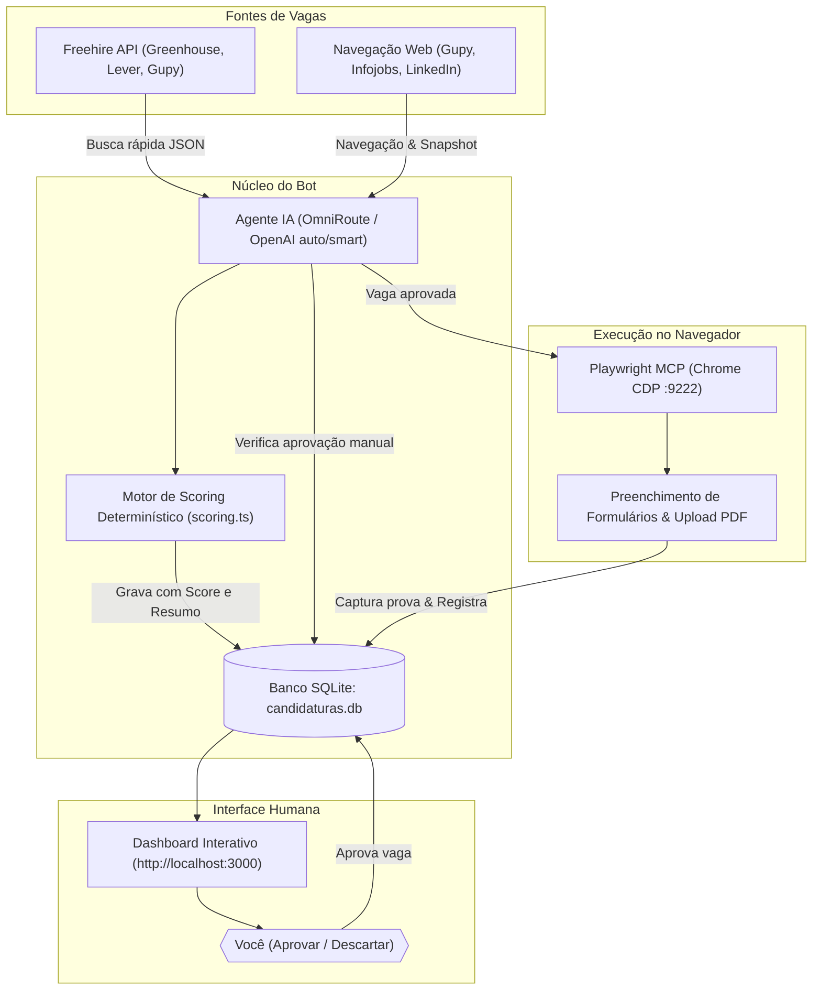

# 🏗️ Arquitetura e Fluxo do Sistema

O **Auto-Apply-Bot** opera em um modelo híbrido de **Agente Autônomo com Supervisão Humana (Human-in-the-Loop)**. Ele combina um motor LLM local para raciocínio, ferramentas de automação web via Playwright MCP e APIs diretas de busca de vagas.

---

## 🗺️ Diagrama de Arquitetura

---

## 🔄 Ciclo de Vida da Vaga

1. **Descoberta:**
   - **Via Freehire API:** Consulta direta em milissegundos sem abrir navegador (`GET https://freehire.me/api/v1/jobs/search`).
   - **Via Browser:** O robô acessa os portais de busca configurados (`portal.gupy.io`, etc.) com o Chrome.

2. **Pontuação & Filtros Eliminatórios (`src/scoring.ts`):**
   - **Score 1-10:** Base 5 + pontos por correspondência de stack (.NET, C#, Azure, SQL Server, etc.).
   - **Eliminatório de Idioma:** Se a vaga exigir inglês avançado/fluente (B2/C1) e o candidato tiver nível básico, o sistema marca como eliminatório e descarta.
   - **Eliminatório de Localização:** Vagas presenciais ou híbridas fora do Rio de Janeiro são eliminadas (apenas remotas são aceitas fora do RJ).

3. **Radar de Oportunidades (`vagas_vistas` no SQLite):**
   - Vagas qualificadas entram com `status_aprovacao = 'pendente'`.
   - Vagas de freelance/PJ ou com taxa horária recebem a identificação `[Freelance/PJ]`.
   - Vagas brasileiras recebem a tag `[PT-BR]`.

4. **Aprovação Humana no Dashboard (`localhost:3000`):**
   - O candidato avalia o título, empresa, score e resumo.
   - Clica em **`[✅ Aprovar]`** ou **`[❌ Descartar]`**.

5. **Execução da Candidatura:**
   - Se `REQUER_APROVACAO=true`, o agente só abre formulários de vagas com status `aprovado`.
   - Lê as respostas-base em `config/respostas.json` e dados do `config/perfil.json`.
   - Preenche os campos, anexa o PDF e passa pelo gate de segurança `confirmar_envio`.

